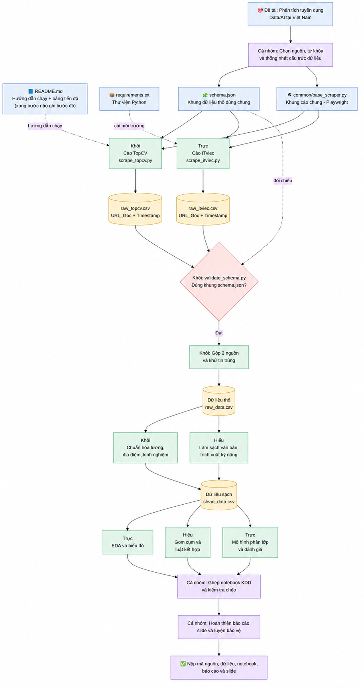

# Phân tích dữ liệu tuyển dụng Data/AI tại Việt Nam

Đồ án môn **Khai phá dữ liệu (ITEC3417)** — **Trường Đại học Mở TP.HCM**.

Nhóm thu thập tin tuyển dụng Data/AI từ các nền tảng việc làm tại Việt Nam, làm sạch dữ liệu và phân tích yêu cầu về kỹ năng, kinh nghiệm, địa điểm và mức lương. Từ bộ dữ liệu này, nhóm thực hiện phân tích khám phá, gom cụm, khai phá luật kết hợp và xây dựng mô hình phân lớp.

Repository đang ở giai đoạn chuẩn bị triển khai. Các nội dung ghi **chờ bổ sung** sẽ được cập nhật khi nhóm thống nhất hoặc có kết quả thực tế. Yêu cầu học thuật được đối chiếu với đề bài môn học (tệp `DeBai.pdf` sẽ được bổ sung riêng).

## Workflow của nhóm



## 1. Thông tin đề tài

- **Tên đề tài chính thức:** Chờ nhóm thống nhất.
- **Phân khúc nghiên cứu:** Tuyển dụng Data/AI tại Việt Nam.
- **Môn học:** Khai phá dữ liệu — ITEC3417.
- **Đơn vị:** Trường Đại học Mở TP.HCM.

## 2. Thông tin nhóm

**Tên / số nhóm:** Chờ bổ sung.

| STT | Họ tên | MSSV | Vai trò | Phần việc | % đóng góp |
| :---: | :--- | :--- | :--- | :--- | :---: |
| 1 | Chờ bổ sung | Chờ bổ sung | Chờ bổ sung | Chờ bổ sung | Chờ xác nhận |
| 2 | Chờ bổ sung | Chờ bổ sung | Chờ bổ sung | Chờ bổ sung | Chờ xác nhận |
| 3 | Chờ bổ sung | Chờ bổ sung | Chờ bổ sung | Chờ bổ sung | Chờ xác nhận |

Tỷ lệ đóng góp được nhóm xác nhận dựa trên công việc thực tế và bằng chứng bàn giao.

## 3. Mục tiêu và câu hỏi nghiên cứu

Đồ án thực hiện quy trình KDD trên dữ liệu tuyển dụng do nhóm tự thu thập. Các phần việc chính gồm:

1. Viết crawler để thu thập tin tuyển dụng và giữ dữ liệu gốc để đối soát.
2. Chuẩn hóa lương, địa điểm, kinh nghiệm; làm sạch văn bản và trích xuất kỹ năng.
3. Phân tích mức lương theo cấp bậc, các kỹ năng phổ biến và sự khác biệt giữa các khu vực.
4. Gom cụm để tìm các nhóm công việc có yêu cầu tương đồng; đánh giá bằng Elbow, Silhouette và giải thích đặc điểm từng cụm.
5. Khai phá các kỹ năng thường xuất hiện cùng nhau bằng Apriori hoặc FP-Growth; xem xét Support, Confidence, Lift > 1.2, Conviction và loại các luật nhiễu hoặc dư thừa.
6. Xây dựng mô hình dự đoán lớp lương hoặc cấp bậc sau khi kiểm tra dữ liệu sạch và EDA. So sánh Decision Tree có khảo sát `ccp_alpha` với ít nhất một mô hình khác; đánh giá bằng Confusion Matrix, Precision, Recall, Macro F1 và phân tích lỗi, overfitting.

**Câu hỏi nghiên cứu cụ thể:** Chờ nhóm bổ sung.

## 4. Phạm vi dữ liệu

- **Phân khúc:** Data/AI.
- **Bộ từ khóa tìm kiếm:** Chờ bổ sung; bao gồm tên vị trí và các kỹ năng cốt lõi trong phân khúc.
- **Nguồn thu thập:** Chờ chốt sau khi kiểm tra mẫu và điều kiện truy cập.
- **Quy mô tối thiểu trong kế hoạch thu thập:** 800 tin tuyển dụng; mục tiêu của nhóm là hơn 800 tin hợp lệ, không trùng sau khi ghép nguồn.

Một tin được tìm thấy qua nhiều từ khóa hoặc nhiều lần thu thập không được tính thành nhiều tin. Bộ dữ liệu chỉ phản ánh các nguồn và thời gian nhóm khảo sát; các kết quả phân tích cần nêu rõ giới hạn này.

## 5. Cấu trúc thư mục

Cấu trúc dưới đây là cấu trúc dự kiến của dự án. Các thư mục, tệp và đường dẫn sẽ được bổ sung, đồng bộ trong quá trình triển khai.

> [!IMPORTANT]
> **Trước mắt, nhóm tập trung xây dựng crawler và thu thập dữ liệu từ TopCV và ITviec.** Vì vậy, cây thư mục hiện chỉ liệt kê mã crawler và thư mục dữ liệu gốc của hai nguồn này.
>
> **VietnamWorks, CareerViet và Glints sẽ được xem xét triển khai ở giai đoạn sau.** Với mỗi nguồn, nhóm cần kiểm tra điều kiện truy cập, chạy thử crawler và kiểm tra dữ liệu thu được. Khi triển khai thành công, nhóm sẽ cập nhật cây thư mục trong README để bổ sung rõ file crawler trong `src/crawlers/` và thư mục dữ liệu tương ứng trong `data/raw/` (ví dụ `vietnamworks.py` và `data/raw/vietnamworks/`). Dữ liệu từ nguồn mới phải theo cùng schema raw và được kiểm tra trùng lặp khi ghép với các nguồn đã có.

```text
DataMining-Open/
├── README.md                      # Giới thiệu, cài đặt, cách chạy, trỏ tới docs/PLAN.md
├── AGENTS.md                      # Luật cho Codex (không bịa, phạm vi, quy ước)
├── requirements.txt               # Python 3.13, ghim ==
├── .gitignore
│
├── docs/
│   ├── DeBai.pdf
│   ├── PLAN.md                    # Nguồn duy nhất cho schema raw/clean, quyết định xử lý
│   └── WORKFLOW.md                # Thứ tự, bàn giao, bảng phân công + mốc thời gian
│
├── configs/                       # Mọi thứ do người viết tay, code chỉ đọc
│   ├── keywords.json              # Từ khóa vị trí + kỹ năng dùng chung cho crawler
│   └── skill_dictionary.csv       # skill, nhóm, các cách viết
│
├── src/
│   ├── __init__.py
│   ├── crawlers/
│   │   ├── __init__.py
│   │   ├── base.py                # delay ngẫu nhiên, Timestamp, ghi CSV đúng schema raw
│   │   ├── topcv.py
│   │   ├── itviec.py
│   │   ├── run_crawl.py           # Điểm vào: một lệnh chạy cả crawler
│   │   └── merge_raw.py           # Gộp file từng lần cào thành raw_data.csv
│   └── preprocessing/
│       ├── __init__.py
│       ├── salary.py
│       ├── location.py
│       ├── experience.py          # Exp_Years, Exp_Group, Level
│       ├── text.py
│       ├── skills.py
│       ├── duplicates.py
│       └── build_clean_data.py    # Điểm vào: raw_data.csv → clean_data.csv
│
├── data/
│   ├── raw/
│   │   ├── topcv/                 # topcv_20261113T0930.csv (mỗi lần cào một file)
│   │   ├── itviec/
│   │   └── raw_data.csv           # Bản gộp để nộp
│   └── processed/
│       └── clean_data.csv
│
├── notebooks/
│   └── NhomXX_MiningPipeline.ipynb  # EDA, gom cụm, luật kết hợp, phân lớp nằm hết trong này
│
├── tests/
│   ├── fixtures/                  # Vài chuỗi lương/kinh nghiệm/JD mẫu thật
│   ├── test_salary.py
│   ├── test_experience.py
│   ├── test_skills.py
│   └── test_duplicates.py
│
├── reports/
│   ├── figures/
│   └── NhomXX_BaoCao_BaiTapLon.pdf
├── slides/
│   └── NhomXX_Slide_BaoCao.pdf
└── TH-01/                         # Bài thực hành cũ, giữ nguyên, không đụng
```

## 6. Schema dữ liệu thô (`data/raw/`)

| Tên cột | Kiểu dữ liệu | Bắt buộc | Mô tả |
| :--- | :--- | :---: | :--- |
| `job_id` | string | Có | Mã ổn định của tin trong nguồn; crawl lại cùng tin vẫn dùng cùng mã |
| `site` | string | Có | Tên trang nguồn tuyển dụng |
| `URL_Goc` | string | Có | Đường dẫn gốc của tin tuyển dụng (dùng để đối soát) |
| `Timestamp` | datetime / string | Có | Thời điểm thu thập, có múi giờ (ví dụ ISO 8601 với `+07:00`) |
| `title` | string | Có | Tiêu đề công việc |
| `company` | string | Có | Tên công ty tuyển dụng |
| `location` | string | Có | Địa điểm làm việc (thô) |
| `salary_raw` | string | Có | Mức lương nguyên bản |
| `experience_raw` | string | Có | Yêu cầu kinh nghiệm nguyên bản |
| `description` | string | Có | Mô tả công việc |
| `requirements` | string | Có | Yêu cầu ứng viên |
| `benefits` | string | Có | Phúc lợi |
| `skills_raw` | string | Tuỳ chọn | Danh sách kỹ năng thô (nếu trang có thẻ riêng) |
| `work_model_raw` | string | Tuỳ chọn | Hình thức làm việc thô (Onsite / Hybrid / Remote) |
| `employment_type_raw` | string | Tuỳ chọn | Loại hình hợp đồng (Full-time / Part-time / Intern...) |
| `posted_at_raw` | string | Tuỳ chọn | Ngày đăng tin nguyên bản |
| `keyword_search` | string / danh sách | Tuỳ chọn | Từ khóa đã dùng để tìm thấy tin; một tin có thể ứng với nhiều từ khóa |

- Bắt buộc có các cột đánh dấu `Có`; giá trị nội dung có thể để thiếu khi nguồn không công bố. Không tự điền giá trị không có trong nguồn.
- Nếu nguồn gộp mô tả, yêu cầu và phúc lợi, giữ nguyên khối văn bản gốc; không tự tạo nội dung cho các phần không tách được. Lưu dữ liệu thô riêng theo từng lần thu thập.
- Các lần tìm thấy cùng một tin không được tính thành nhiều tin. Quy tắc xác định tin hợp lệ và trùng lặp sẽ được nhóm thống nhất sau khi kiểm tra mẫu nguồn.

## 7. Schema dữ liệu sạch (`data/clean/`) — Dự kiến

Mỗi dòng trong bộ sạch cuối đại diện cho một tin hợp lệ, không trùng. Giữ các cột gốc cần đối soát cùng các cột chuẩn hóa sau:

| Nhóm trường | Tên cột | Mô tả |
| :--- | :--- | :--- |
| **Truy vết** | `job_id`, `site`, `URL_Goc`, `Timestamp` | Nhận diện tin, nguồn và lần thu thập; liên kết về dữ liệu thô bằng `job_id` |
| **Thông tin cơ bản** | `title`, `company` | Tiêu đề và tên công ty để đọc và giải thích kết quả |
| **Lương** | `salary_raw` | Lương nguyên bản để đối soát |
| **Lương** | `Luong_Min`, `Luong_Max` | Hai cận lương đã chuẩn hóa về cùng đơn vị và kỳ trả; cận không xác định để thiếu |
| **Lương** | `salary_status` | Trạng thái: có số / thỏa thuận / thiếu / chưa xử lý được |
| **Lương** | `salary_basis` | Gross / Net / không rõ |
| **Địa điểm** | `Location_Std` | Tỉnh/thành làm việc chuẩn hóa; quy tắc biểu diễn và đếm tin nhiều địa điểm do nhóm thống nhất |
| **Kinh nghiệm** | `experience_raw`, `Exp_Group` | Yêu cầu gốc và nhóm kinh nghiệm theo quy tắc được ghi rõ |
| **Cấp bậc** | `Level` | Intern, Fresher, Junior, Middle, Senior, Lead hoặc không xác định; chỉ gán khi có căn cứ |
| **Văn bản** | `requirements_clean` | Phần yêu cầu đã làm sạch để trích xuất kỹ năng |
| **Văn bản** | `description_clean` | Tùy chọn: mô tả đã làm sạch khi có nội dung cần phân tích |
| **Kỹ năng** | `skill_<nhóm>_<tên>` | Mã hóa one-hot theo `skill_dictionary.csv`; `<nhóm>` gồm `lang`, `framework`, `cloud`, `db`, `soft` |

- Quy định và ghi lại đơn vị, kỳ trả lương sau chuẩn hóa; khi quy đổi ngoại tệ, lưu nguồn và ngày tỷ giá cùng cách xử lý. Không gán lương thiếu hoặc thỏa thuận bằng 0. Không tự đặt cận còn thiếu cho khoảng một đầu.
- Chỉ tính `Luong_Mid` khi có đủ hai cận đáng tin cậy. `Salary_Bracket` có thể tạo sau EDA nếu chọn dự đoán lớp lương; ghi rõ quy tắc tạo nhãn và loại thông tin làm lộ nhãn khỏi đầu vào.
- Quy định nguồn văn bản và cách trích kỹ năng; không suy ra kỹ năng bắt buộc chỉ từ nội dung quảng cáo công ty. Giá trị 0 nghĩa là không tìm thấy theo phương pháp trích xuất, không khẳng định kỹ năng không được yêu cầu; phân biệt trường hợp thiếu nội dung để trích xuất.
- Ghép kết quả xử lý bằng `job_id`, kiểm tra quan hệ một-một. Theo dõi số tin và lý do loại qua từng bước; cờ trùng lặp có thể dùng trong dữ liệu trung gian trước khi tạo bộ sạch cuối.

## 8. Môi trường phát triển

Dự án sử dụng **Python 3.13** và **Git**. Mỗi thành viên dùng môi trường ảo `.venv` cho dự án. Nếu crawler sử dụng Selenium với Chrome, máy cần cài Google Chrome.

Các thư viện trực tiếp và phiên bản đã kiểm tra được ghim trong `requirement.txt`. Cài các phiên bản trong tệp bằng các lệnh bên dưới.

Chạy các lệnh từ thư mục gốc của repository.

**Windows — PowerShell hoặc Command Prompt:**

```powershell
py -3.13 --version
py -3.13 -m venv .venv
.\.venv\Scripts\python.exe --version
.\.venv\Scripts\python.exe -m pip install -r requirement.txt
```

Nếu `.venv` đã được tạo bằng phiên bản Python khác, hãy tạo lại môi trường bằng Python 3.13 trước khi cài thư viện.

**macOS / Linux:**

```bash
python3.13 --version
python3.13 -m venv .venv
.venv/bin/python --version
.venv/bin/python -m pip install -r requirement.txt
```

Các lệnh trên gọi trực tiếp Python trong môi trường ảo. Khi chạy mã dự án hoặc mở notebook, sử dụng đúng môi trường này để tránh lệch thư viện giữa các thành viên.

## 9. Cách chạy lại crawler

**Lệnh chạy, tham số và vị trí tệp đầu ra:** Chờ bổ sung sau khi có crawler. Hiện repository chưa có mã crawler để chạy.

Khi triển khai thu thập dữ liệu, nhóm tuân thủ các nguyên tắc sau:

- Tự viết crawler, không dùng dịch vụ cào dữ liệu trả phí.
- Kiểm tra `robots.txt` và điều kiện sử dụng của nguồn trước khi thu thập.
- Đặt khoảng chờ ngẫu nhiên giữa các lần gửi yêu cầu; giới hạn số lần thử lại và ghi nhận lỗi.
- Kiểm tra phân trang và cách tải nội dung trước khi thu thập số lượng lớn. Nếu bị chặn hoặc yêu cầu đăng nhập, ghi nhận và chọn cách tiếp cận được cho phép.
- Giữ nội dung gốc, URL và thời điểm thu thập. Không ghi dữ liệu làm sạch đè lên dữ liệu thô.

Nhóm chuẩn bị một lần chạy thử lấy vài trang thật để kiểm tra crawler và phục vụ demo.

## 10. Cách chạy notebook

**Tên notebook tích hợp và thứ tự chạy cụ thể:** Chờ bổ sung. Hiện repository chưa có notebook để chạy.

Sau khi notebook được bổ sung, mở thư mục `notebooks/`, chọn kernel thuộc `.venv` và chạy theo thứ tự đánh số. Các notebook cần chạy được từ đầu đến cuối bằng **Restart & Run All** trên một kernel mới.

Notebook trình bày quy trình từ dữ liệu đã lưu đến EDA, gom cụm, luật kết hợp và phân lớp. Các bước có ngẫu nhiên phải cố định `random_state`. Mỗi kết quả cần nêu tập dữ liệu được dùng, số mẫu và cách xử lý giá trị thiếu.

## 11. Quy ước làm việc nhóm

- Nhánh chính là `main`. Mỗi phần việc được thực hiện trên một nhánh riêng, ví dụ `feat/<tên>-<việc>`, rồi mở Pull Request để review trước khi merge.
- Dùng tiền tố commit rõ nghĩa như `feat:`, `fix:`, `docs:` hoặc `chore:` và mô tả ngắn việc đã thay đổi.
- Đặt tên sản phẩm nộp theo chuẩn `NhomXX_...` trong đề bài.
- **Người giữ notebook tích hợp:** Chờ nhóm xác nhận.
- Mỗi thành viên cấu hình `git config user.name` và `git config user.email` đúng thông tin của mình.
- Không đưa `.venv`, cache, token, cookie hoặc tệp `.env` lên repository. Dữ liệu cần được rà soát trước khi commit.

## 12. Trung thực học thuật và kiểm tra dữ liệu

Mọi thành viên cần hiểu và giải thích được toàn bộ quy trình, mã nguồn và kết quả nhóm nộp. Không tạo tin tuyển dụng, URL, thời điểm thu thập, nhãn hoặc kết quả không có căn cứ. Giữ `URL_Goc` và `Timestamp` để có thể kiểm tra lại dữ liệu với nguồn.

Khi xây dựng mô hình, tránh rò rỉ dữ liệu theo các nguyên tắc sau:

- Ghi rõ cách tạo nhãn. Không dùng các cột lương để dự đoán lớp lương; không dùng đầu vào chứa trực tiếp cấp bậc khi dự đoán cấp bậc. Tiêu đề hoặc kinh nghiệm cũng cần được xem xét nếu chúng là nguồn tạo nhãn.
- Tách tập test trước khi học các phép biến đổi hoặc chọn tham số. Bộ điền thiếu, encoder, scaler và từ vựng học từ dữ liệu chỉ được fit trên train hoặc các phần train trong cross-validation.
- Loại trùng trước khi chia tập hoặc giữ các tin trùng, đăng lại ở cùng một phía để tránh đánh giá quá lạc quan.
- Phân biệt các bước đã viết với các bước đã chạy và kiểm tra thành công.

## 13. Các hạng mục bàn giao

Tiến độ và bằng chứng đóng góp được cập nhật trong workbook phân công của nhóm. README liệt kê các đầu ra cần có:

- Mã crawler, `requirement.txt` và hướng dẫn chạy lại, kèm phần demo thu thập một mẫu nhỏ.
- Dữ liệu thô và dữ liệu sạch, cùng thống kê số tin qua các bước xử lý.
- Notebook tích hợp có EDA, gom cụm, luật kết hợp và phân lớp; chạy được từ đầu đến cuối.
- Báo cáo PDF trình bày phương pháp, kết quả, hạn chế và phân công đóng góp.
- Slide thuyết trình và phần chuẩn bị demo, giải thích mã nguồn khi bảo vệ.

Tên tệp nộp cụ thể sẽ được cập nhật sau khi có số nhóm.

## 14. Hạn chế đã biết

Chờ bổ sung sau khi khảo sát nguồn và có dữ liệu thực tế. Nhóm sẽ ghi rõ mức độ thiếu dữ liệu, giới hạn thu thập và ảnh hưởng của các quyết định xử lý đến kết quả phân tích.
